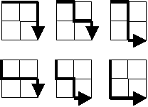

Benedikt is a Renaissance antiqua by Hans Heitmann (Finaltype). Its
capitals derive from Roman monumental inscriptions and its italic from 6th-century Roman wax-tablet
handwriting. The site uses the four basic styles: **Regular**, *Italic*, **Bold** and ***Bold Italic***.

* toc
{:toc}

## Body text

Running text uses old-style figures, which sit at lowercase height: I started solving Project Euler
problems in 2015 and have written up 130 of them since, most between 2015 and 2020. Italic is
reserved for short spans such as *emphasis*, titles of works like *A Mathematician's Apology*, and
cross-references. Hyphenation is automatic, so long words such as incomprehensibilities and
electroencephalography break cleanly at narrow widths.

Contextual alternates (`calt`) are always on: they swap in alternate letterforms depending on the
neighbouring letters, as in *after*, *offer*, *flight*, *stuff*, *market*, *together* and *river*.
They also handle number punctuation, such as the range 2015-2020 and the ratio 3:4.

## Figures by context

| Context | Example | Setting |
|---|---|---|
| Running prose | 1234567890 | `oldstyle-nums` on `.content` |
| Bold answers, headings | **1234567890** | `proportional-nums` (lining) |
| Tables | 1234567890 | default: lining, tabular |
| Dates, tags, metadata | 1234567890 | `all-small-caps` |

The answer to #137 is **1120149658760**, and the 15th golden nugget appears after 30 Fibonacci terms.
Old-style figures in the sentence, lining proportional figures in the bold answer.

Tables keep tabular figures so columns line up:

| $n$ | $F_n$ | $F_nF_{n+1}$ |
|---:|---:|---:|
| 10 | 55 | 4895 |
| 20 | 6765 | 74049690 |
| 30 | 832040 | 1120149658760 |

All four figure styles side by side, for reference:

| Feature | Figures |
|---|---|
| Default (lining, tabular) | 0123456789 |
| Lining, proportional | 0123456789 |
| Old-style (tabular widths only) | 0123456789 |
| Small-cap figures | 0123456789 |

## Small caps

Small caps exist in the upright styles only. The italics have none, and the site never fakes them
(`font-synthesis: none`).

**Abbreviations.** Terms listed in `_includes/abbreviations.md` are wrapped in `<abbr>` on every page
and set in small caps, with the expansion on hover: NLP, CNN, GPU, ASCII, XOR, GCP and EMNLP. Compare
an undefined term set in full capitals: KATEX.

Benedikt's small caps are only about 5% taller than its lowercase, so acronyms are set 10% larger than
the surrounding text. Size comparison:

| Size | Sample |
|---|---|
| 1.0× (plain small caps) | Trained a CNN on a GPU for the NLP task |
| 1.1× (current) | Trained a CNN on a GPU for the NLP task |
| 1.2× | Trained a CNN on a GPU for the NLP task |
| Full capitals | Trained a C&#8288;NN on a G&#8288;PU for the N&#8288;LP task |

**Labels.** **Note**{:.label} Labels like this use the `.label` class, written as
`**Note**{:.label}` in Markdown. So do figure captions and the problem number:
Problem 137.

**Roman numerals.** Problem #89 converts numerals such as XVI,
MCMXC and XLIX into their minimal form, written as
`XVI`. Kramdown's `{:.sc}` only attaches to formatted text (bold, italic,
links), not to plain text, so plain words need the HTML span.

**Openers.** The first sentence of this page is set in small caps by wrapping it in
`…`. A whole sentence, rather than the first line, so the small caps
never stop in the middle of a word at a line break.

**Site furniture.** The breadcrumbs above the title, the post date and tag line on posts, the
sidebar menu, pagination and the footer are all set in spaced small caps, with small-cap figures.

**Italic has no small caps.** Compare upright NLP with italic
*NLP*: the italic falls back to full capitals rather than a faked version.

## Stylistic sets

Benedikt has six forms of g. Titles currently use the ss04 g; body text keeps the default.

| Set | Sample |
|---|---|
| Default | g · gauge, figure, giggling |
| ss01 | g · gauge, figure, giggling |
| ss02 | g · gauge, figure, giggling |
| ss03 | g · gauge, figure, giggling |
| ss04 (titles) | g · gauge, figure, giggling |
| ss05 | g · gauge, figure, giggling |

ss01 also changes other letters: a d g i m q r t Q 4 $ &amp;
versus the default a d g i m q r t Q 4 $ &amp;.

## Ligatures

Standard ligatures are on everywhere: fi fl ft fr fk fh fb kt gy, and capital pairs such as TT, LA,
RA, TY and FT, as in ATTENTION, LATERAL, RATIO, TYPE and SOFT.

Discretionary ligatures are used in titles only. Off and on:

| | Sample |
|---|---|
| Off (body text) | FT TT kt ty · softly, pretty |
| On (titles) | FT TT kt ty · softly, pretty |

## Headings

### A third-level heading with figures 2019

#### A fourth-level heading

Page and post titles are Bold with discretionary ligatures and the ss04 g. Candidates for
comparison:

#137 – Fibonacci golden nuggets

Bold (current)

#137 – Fibonacci golden nuggets

Regular

#137 – Fibonacci golden nuggets

Small caps

#137 – Fibonacci golden nuggets

Spaced capitals (rejected)

## Links

Cross-references between posts read like book cross-references, in italic:
see [#137 - Fibonacci golden nuggets](/blog/project_euler/2019-06-21-137-Fibonacci-golden-nuggets/){:.heading.flip-title}
and [#140 - Modified Fibonacci golden nuggets](/blog/project_euler/2019-06-23-140-Modified-Fibonacci-golden-nuggets/){:.heading.flip-title}.
Clicking one plays the title animation, which crossfades from the italic link to the title style.

Ordinary links use a thin underline that skips descenders: [the projects page](/projects/).
External links are marked with an arrow: [Project Euler](https://projecteuler.net).

## Maths

Formulas keep KaTeX's own fonts, scaled to match Benedikt's x-height. Inline: the $k^{\text{th}}$
golden nugget is $F_{2k}F_{2k+1}$, and $A_F(x) = \frac{x}{1-x-x^2}$. Text inside formulas, such as
$\text{sopf}(n)$, is set in Benedikt.

$$
A_F\left(\frac{F_n}{F_{n+1}}\right) = (-1)^nF_nF_{n+1}
$$

Short expressions in plain text stay in Benedikt: n ≤ 1000, a ≠ b, x × y ÷ z, ±1, 90°, √2,
∑ and ∏, ∞, π and Ω. Benedikt has no true minus sign (−), primes (′ ″) or arrows; those come from a
fallback font.

## Footnotes

Footnote references use superscript figures.[^first] Benedikt has real superscripts for 1–3,
and the browser simulates the rest.[^second]

[^first]: Fick, S.E. and R.J. Hijmans, 2017. WorldClim 2.
[^second]: A second footnote.

## Captions

{:style="display:block; margin-left:auto; margin-right:auto"}

Figure 1 Lattice paths through a 2 × 2 grid.
{:.figcaption}

The caption label gets a period and a little extra space from CSS, so Markdown only needs
`Figure 1`. Other separators, for comparison:

Figure 1: Lattice paths through a 2 × 2 grid.

Figure 1 – Lattice paths through a 2 × 2 grid.

Figure 1 · Lattice paths through a 2 × 2 grid.

Figure 1 Lattice paths through a 2 × 2 grid.

## Problem statements

> Consider the infinite polynomial series $A_F(x) = xF_1 + x^2F_2 + x^3F_3 + \dots$, where $F_k$ is
> the $k^{\text{th}}$ term in the Fibonacci sequence. Find the 15th golden nugget.
{:.lead}

Problem statements are set in Regular at 0.95em, not italic.

## Other languages

Phrases marked with a `lang` attribute get Benedikt's language-specific forms, e.g. Romanian
*știință*{:lang="ro"}, Polish *łódź*{:lang="pl"}, Turkish *ılık*{:lang="tr"}, German
*Straße*{:lang="de"} and French *déjà vu*{:lang="fr"}.

## Character coverage

Typographic punctuation: ‘single’ “double” quotes, apostrophes’, en – and em — dashes, ellipsis …,
guillemets «» ‹›, dagger † ‡, section § and pilcrow ¶. Currency: $ € £ ¥ ¢. Fractions ½ ¼ ¾ and
superscripts ¹ ² ³ are built in; other fractions are not.
